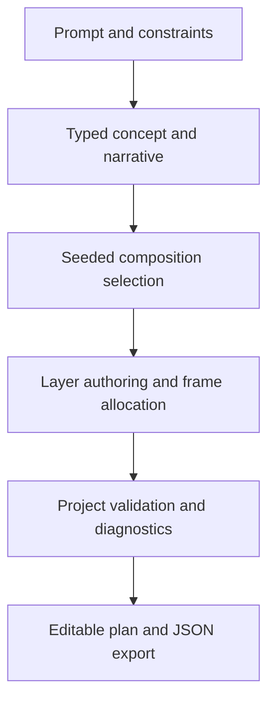

# Video Engine V2 — audit and implementation plan

Audit date: 2026-10-26. Backend base: 6dc279fbbfdec0cfa1cc9d3ec852beb9db7bb63f.
Viewer base: d54c59a9e35d7854cb9cdd95c4954c89862ee898. Branch: feat/video-engine-v2 in both repositories.

## Current architecture
FastAPI app.py authenticates video mutations with require_diagnostics_auth.
motion_video/service.py plans synchronously through LiteLLM, optionally generates one Canvas
program and Gemini narration, then creates a Vercel Sandbox and uploads request/status/worker.
motion_video/storyboard.py validates and repairs model JSON. worker.py builds HTML/CSS scenes,
downloads motion-video-skill, installs Chromium/FFmpeg, and invokes its check/render CLI.
MP4 downloads proxy Sandbox files. Job history is a Sandbox listing; filesystem snapshots
expire after 24 hours. The React/Vite/TypeScript viewer retains its existing chat and video flows.

## Root causes of visual repetition
- StoryScene has five kinds and five visuals; validation mandates hero, screen, outro.
- Repair normalizes unrecognized visuals to dashboard or product and adds required UI content.
- Most non-image scenes share film-stage and the same visual DOM constructors.
- Generated Canvas drawing is restricted to ONE eligible middle scene; images disable it.
- Invalid generated drawings are replaced with preset scenes, including render-time fallback.
- No seed, numerical diversity objective, benchmark baseline or repeat penalty exists.
- Model temperature is 0.25; instructions encourage variation but do not measure it.
- Fixed scene counts, narrowly weighted timing and limited camera choices reinforce sameness.

## Existing strengths to preserve
Bounded image validation, authenticated rendering, provider failover with total planning timeout,
physical-product grounding, image index checks, explicit voice timing rejection, atomic status
updates, preview/standard dimensions, readable palette corrections, async Sandbox execution,
snapshot retention limits, download/delete/history routes and video regression tests.

## Reliability, performance and cost gaps
Planning precedes job creation, so failures have no durable checkpoint or job ID.
Sandbox persistence is temporary, not a durable job database. Processes do not survive resume.
No scene-level content-addressed cache, resume route, cancellation marker or concurrency lease.
Cold renders clone an unpinned upstream repository and install dependencies. Timeout budgets
are per command and can exceed the session budget. Failed custom visuals rerender the full film.
Success relies on upstream check/render output and file existence, without local stream/decode
validation. SFX may be omitted after sync failure. Voice generation is serial and trims phrases.
No measured production cost, CPU/memory profile or abandoned-job reconciliation is available.
No evidence yet of account-specific available Sandbox quota.

## Technology decision
Keep the working HTML/Chromium renderer for legacy jobs. Add an opt-in, typed V2 planning
contract first. Deterministic declarative scene data is preferable to model-authored executable
JavaScript. Reuse existing Python/Pydantic, provider routing and image limits. Keep FFmpeg as
the encoding/validation boundary. Do not add GSAP/Motion/R3F/Remotion solely for branding:
each adds runtime/dependency work; deterministic timestamps and a renderer capability contract
must come first. True 3D/shape morphing/character consistency require separate verified support.

## Ordered milestones and gates
1. Versioned creative brief, narrative/scene/layer/motion/transition schemas, seeded diversity,
   plan validation, plan-only API and metadata benchmark against ten prompt categories.
2. Frame-seekable motion primitives and composition-aware transitions that actually render;
   validate real MP4s and inspect sample frames. Expose only supported capabilities.
3. Content-addressed scene checkpoints, bounded retry, cooperative cancellation, process lease,
   output validation and an injected-failure recovery test. Document snapshot expiry limits.
4. Accessible storyboard editor with reorder/duplicate/delete, copy/duration/motion controls,
   preview and export. Preserve old jobs; validate edits on the server.
5. Reuse available narration provider, validate clips, synchronize captions and one style spec.
6. Deterministic QA, benchmark report, local performance measurements and CI checks.
   Never label synthetic/mocked-provider measurements as production performance or cost.

## Infrastructure alternative
For durable recovery beyond the Sandbox retention window, persist project/job/checkpoint
manifests in an existing database and outputs in object storage, dispatch to a bounded external
render worker. This is required before claiming indefinite recovery or fleet-wide concurrency
control. Keep rendering out of chat processes. No new paid provider is required for the initial
planning implementation. Provider calls and Sandbox renders retain their existing usage costs.

## Audit limits
This is a source audit, not a production load test. No live paid generation was started.
Visual, browser playback, quota and provider claims require subsequent evidence.

## Implemented increment — planning foundation (2026-10-26)

This branch is an incomplete V2 implementation. It does not yet improve exported MP4s.
The existing V1 renderer remains the only export path. V2 plans explicitly return
render_ready=false and are never silently compiled into V1 templates.

### Backend
motion_video/v2/models.py: strict version 2.0 creative brief, style, narrative outline,
scene/layer/asset/motion/transition contracts. Integer frame accounting includes overlaps.
Unknown fields, duplicate IDs, invalid references, off-frame rectangles, non-finite values
and changed locked stages are rejected.
diversity.py: seeded bounded composition search before scene authoring; conservative,
balanced and experimental repetition penalties; largest-remainder frame allocation;
metadata metrics and scene-specific planning diagnostics.
planner.py: separate concept and actual layer-authoring calls via the existing LiteLLM
router. Bounded provider failover, one schema correction, 105s overall planning and 70s
revision budgets. Targeted brief/storyboard/scene/motion revision. Brief changes mark
dependent stages stale. The seed reproduces selection for the same outline; live model
text is not guaranteed deterministic. Concept checkpoint data is returned to the caller,
not persisted in a durable job store.
api.py: authenticated POST /v1/video/v2/plan, /revise and /validate, guarded by the existing
video feature/auth readiness. Planning never creates a Sandbox. Status advertises
planning_v2_enabled and planning_v2_render_enabled=false.

### Viewer
src/videoV2.ts, src/components/VideoPlanEditor.tsx, src/video-v2.css: progressively disclosed
planning editor, composition sketches, exact frame timeline, reorder/duplicate/delete,
headline/narration/on-screen copy edits, camera choice, frame duration editing, targeted
scene/motion/storyboard revision, validation and JSON export. Sketches are static bounding
box previews, not rendered thumbnails. A backend capability flag gates planning on older
servers. Current V1 video jobs/history and image flow remain available.
Mobile icon navigation now has persistent accessible labels. jsdom is a development-only
dependency; a lockfile and branch CI coverage were added.

### Evidence and limitations
- 24 initial planning unit tests passed; the final overcrowded-outline regression brought
  the unit suite to 25, all passing.
- 7 HTTP boundary tests passed with the actual app/auth and mocked planning calls.
- 64 targeted backend video tests passed before the final additional unit regression.
- Viewer: 44 tests passed, including DOM edits, errors, API authentication and retiming;
  TypeScript/Vite production build passed.
- Browser with mocked backend: 390x844 touch viewport; plan, duplicate, delete, reorder and
  validate succeeded; exact 360-frame timeline; no page/editor horizontal overflow or
  page errors. Desktop screenshot was also captured. This does not verify a physical phone
  or live provider behavior.
- Full backend run: 498 passed, 3 failed, 8 subtests passed before HTTP tests were added.
  An unchanged baseline reproduced the same 3 failures (474 passed): existing RAG model
  alias retrieval expectations in tests/test_rag_ranking.py. They were not suppressed.
- Offline selector benchmark: 10 hand-authored prompt-category fixtures × 5 seeds;
  4 unique sequences per category, zero within-video composition repetition. Comparison
  is to unpenalized first-choice selection on identical fixture candidates, NOT to
  generated V1 videos. No live prompt-adherence, visual similarity or video quality score.
- Measured selector runtime: see video-v2-benchmark.json (~0.044s in this workspace).
  This is not render latency. Production cost/CPU/memory/render success rate are unknown.
- No new backend dependency or paid service. Planning adds a second model stage and can
  use bounded corrections/failover; actual provider cost is unknown without pricing.
- No live model or Sandbox verification: backend/provider/Vercel credentials were absent
  in this workspace. No V2 sample MP4 is supplied.

### Remaining milestones
2: deterministic motion renderer and transition compatibility, real MP4 examples.
3: scene cache/checkpoints, durable state, cancellation, recovery, decode/output QA.
4: actual animated preview, rendered thumbnails, asset replacement and final export.
5: measured narration sync, captions, audio mix/ducking and asset consistency enforcement.
6: pixel/audio QA, real multi-seed video benchmark, rendering performance/cost telemetry.
Before calling milestone 1 end-to-end verified, run live concept/layer authoring against
a credentialed development backend and inspect the resulting project quality. Do not
merge or claim production readiness based on mock-provider tests.

## Planning flow

## Local verification
Backend: install requirements-dev.txt, then run python -m pytest tests/video_v2 -q.
Existing app-lifespan tests require a configured baseline deployment or an offline
placeholder provider key for initialization; mocked tests must never send paid requests.
Viewer: npm ci, npm test, npm run build.
Benchmark: python scripts/benchmark_video_v2.py --output docs/video-v2-benchmark.json.

