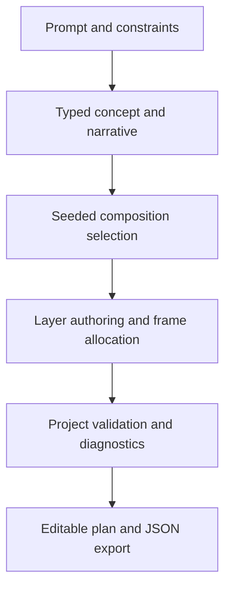

# Video Engine V2 — audit and implementation plan

Current export/recovery status is documented in the follow-up section at the end.
The earlier planning-only status is retained as implementation history.

Audit date: 2026-10-26. Backend base: 6dc279fbbfdec0cfa1cc9d3ec852beb9db7bb63f.
Viewer base: d54c59a9e35d7854cb9cdd95c4954c89862ee898. Branch: feat/video-engine-v2 in both repositories.

## Current architecture
FastAPI app.py authenticates video mutations with require_diagnostics_auth.
motion_video/service.py plans synchronously through LiteLLM, optionally generates one Canvas
program and Gemini narration, then creates a Vercel Sandbox and uploads request/status/worker.
motion_video/storyboard.py validates and repairs model JSON. worker.py builds HTML/CSS scenes,
downloads motion-video-skill, installs Chromium/FFmpeg, and invokes its check/render CLI.
MP4 downloads proxy Sandbox files. Job history is a Sandbox listing; filesystem snapshots
expire after 24 hours. The React/Vite/TypeScript viewer retains its existing chat and video flows.

## Root causes of visual repetition
- StoryScene has five kinds and five visuals; validation mandates hero, screen, outro.
- Repair normalizes unrecognized visuals to dashboard or product and adds required UI content.
- Most non-image scenes share film-stage and the same visual DOM constructors.
- Generated Canvas drawing is restricted to ONE eligible middle scene; images disable it.
- Invalid generated drawings are replaced with preset scenes, including render-time fallback.
- No seed, numerical diversity objective, benchmark baseline or repeat penalty exists.
- Model temperature is 0.25; instructions encourage variation but do not measure it.
- Fixed scene counts, narrowly weighted timing and limited camera choices reinforce sameness.

## Existing strengths to preserve
Bounded image validation, authenticated rendering, provider failover with total planning timeout,
physical-product grounding, image index checks, explicit voice timing rejection, atomic status
updates, preview/standard dimensions, readable palette corrections, async Sandbox execution,
snapshot retention limits, download/delete/history routes and video regression tests.

## Reliability, performance and cost gaps
Planning precedes job creation, so failures have no durable checkpoint or job ID.
Sandbox persistence is temporary, not a durable job database. Processes do not survive resume.
No scene-level content-addressed cache, resume route, cancellation marker or concurrency lease.
Cold renders clone an unpinned upstream repository and install dependencies. Timeout budgets
are per command and can exceed the session budget. Failed custom visuals rerender the full film.
Success relies on upstream check/render output and file existence, without local stream/decode
validation. SFX may be omitted after sync failure. Voice generation is serial and trims phrases.
No measured production cost, CPU/memory profile or abandoned-job reconciliation is available.
No evidence yet of account-specific available Sandbox quota.

## Technology decision
Keep the working HTML/Chromium renderer for legacy jobs. Add an opt-in, typed V2 planning
contract first. Deterministic declarative scene data is preferable to model-authored executable
JavaScript. Reuse existing Python/Pydantic, provider routing and image limits. Keep FFmpeg as
the encoding/validation boundary. Do not add GSAP/Motion/R3F/Remotion solely for branding:
each adds runtime/dependency work; deterministic timestamps and a renderer capability contract
must come first. True 3D/shape morphing/character consistency require separate verified support.

## Ordered milestones and gates
1. Versioned creative brief, narrative/scene/layer/motion/transition schemas, seeded diversity,
   plan validation, plan-only API and metadata benchmark against ten prompt categories.
2. Frame-seekable motion primitives and composition-aware transitions that actually render;
   validate real MP4s and inspect sample frames. Expose only supported capabilities.
3. Content-addressed scene checkpoints, bounded retry, cooperative cancellation, process lease,
   output validation and an injected-failure recovery test. Document snapshot expiry limits.
4. Accessible storyboard editor with reorder/duplicate/delete, copy/duration/motion controls,
   preview and export. Preserve old jobs; validate edits on the server.
5. Reuse available narration provider, validate clips, synchronize captions and one style spec.
6. Deterministic QA, benchmark report, local performance measurements and CI checks.
   Never label synthetic/mocked-provider measurements as production performance or cost.

## Infrastructure alternative
For durable recovery beyond the Sandbox retention window, persist project/job/checkpoint
manifests in an existing database and outputs in object storage, dispatch to a bounded external
render worker. This is required before claiming indefinite recovery or fleet-wide concurrency
control. Keep rendering out of chat processes. No new paid provider is required for the initial
planning implementation. Provider calls and Sandbox renders retain their existing usage costs.

## Audit limits
This is a source audit, not a production load test. No live paid generation was started.
Visual, browser playback, quota and provider claims require subsequent evidence.

## Implemented increment — planning foundation (2026-10-26)

This branch is an incomplete V2 implementation. It does not yet improve exported MP4s.
The existing V1 renderer remains the only export path. V2 plans explicitly return
render_ready=false and are never silently compiled into V1 templates.

### Backend
motion_video/v2/models.py: strict version 2.0 creative brief, style, narrative outline,
scene/layer/asset/motion/transition contracts. Integer frame accounting includes overlaps.
Unknown fields, duplicate IDs, invalid references, off-frame rectangles, non-finite values
and changed locked stages are rejected.
diversity.py: seeded bounded composition search before scene authoring; conservative,
balanced and experimental repetition penalties; largest-remainder frame allocation;
metadata metrics and scene-specific planning diagnostics.
planner.py: separate concept and actual layer-authoring calls via the existing LiteLLM
router. Bounded provider failover, one schema correction, 105s overall planning and 70s
revision budgets. Targeted brief/storyboard/scene/motion revision. Brief changes mark
dependent stages stale. The seed reproduces selection for the same outline; live model
text is not guaranteed deterministic. Concept checkpoint data is returned to the caller,
not persisted in a durable job store.
api.py: authenticated POST /v1/video/v2/plan, /revise and /validate, guarded by the existing
video feature/auth readiness. Planning never creates a Sandbox. Status advertises
planning_v2_enabled and planning_v2_render_enabled=false.

### Viewer
src/videoV2.ts, src/components/VideoPlanEditor.tsx, src/video-v2.css: progressively disclosed
planning editor, composition sketches, exact frame timeline, reorder/duplicate/delete,
headline/narration/on-screen copy edits, camera choice, frame duration editing, targeted
scene/motion/storyboard revision, validation and JSON export. Sketches are static bounding
box previews, not rendered thumbnails. A backend capability flag gates planning on older
servers. Current V1 video jobs/history and image flow remain available.
Mobile icon navigation now has persistent accessible labels. jsdom is a development-only
dependency; a lockfile and branch CI coverage were added.

### Evidence and limitations
- 24 initial planning unit tests passed; the final overcrowded-outline regression brought
  the unit suite to 25, all passing.
- 7 HTTP boundary tests passed with the actual app/auth and mocked planning calls.
- 64 targeted backend video tests passed before the final additional unit regression.
- Viewer: 44 tests passed, including DOM edits, errors, API authentication and retiming;
  TypeScript/Vite production build passed.
- Browser with mocked backend: 390x844 touch viewport; plan, duplicate, delete, reorder and
  validate succeeded; exact 360-frame timeline; no page/editor horizontal overflow or
  page errors. Desktop screenshot was also captured. This does not verify a physical phone
  or live provider behavior.
- Full backend run: 498 passed, 3 failed, 8 subtests passed before HTTP tests were added.
  An unchanged baseline reproduced the same 3 failures (474 passed): existing RAG model
  alias retrieval expectations in tests/test_rag_ranking.py. They were not suppressed.
- Offline selector benchmark: 10 hand-authored prompt-category fixtures × 5 seeds;
  4 unique sequences per category, zero within-video composition repetition. Comparison
  is to unpenalized first-choice selection on identical fixture candidates, NOT to
  generated V1 videos. No live prompt-adherence, visual similarity or video quality score.
- Measured selector runtime: see video-v2-benchmark.json (~0.044s in this workspace).
  This is not render latency. Production cost/CPU/memory/render success rate are unknown.
- No new backend dependency or paid service. Planning adds a second model stage and can
  use bounded corrections/failover; actual provider cost is unknown without pricing.
- No live model or Sandbox verification: backend/provider/Vercel credentials were absent
  in this workspace. No V2 sample MP4 is supplied.

### Remaining milestones
2: deterministic motion renderer and transition compatibility, real MP4 examples.
3: scene cache/checkpoints, durable state, cancellation, recovery, decode/output QA.
4: actual animated preview, rendered thumbnails, asset replacement and final export.
5: measured narration sync, captions, audio mix/ducking and asset consistency enforcement.
6: pixel/audio QA, real multi-seed video benchmark, rendering performance/cost telemetry.
Before calling milestone 1 end-to-end verified, run live concept/layer authoring against
a credentialed development backend and inspect the resulting project quality. Do not
merge or claim production readiness based on mock-provider tests.

## Planning flow

## Local verification
Backend: install requirements-dev.txt, then run python -m pytest tests/video_v2 -q.
Existing app-lifespan tests require a configured baseline deployment or an offline
placeholder provider key for initialization; mocked tests must never send paid requests.
Viewer: npm ci, npm test, npm run build.
Benchmark: python scripts/benchmark_video_v2.py --output docs/video-v2-benchmark.json.

## Follow-up implementation — deterministic export and recovery

This section supersedes the earlier planning-only limitations. The core V2 path now
renders real MP4 files locally. It remains an experimental 2D/2.5D engine, not a
completed implementation of the entire master specification or a demonstrated
professional creative-quality target.

### What is implemented
- motion.py: timestamp-independent entrance/exit choreography, smooth/cubic/spring
  easing, drift/pulse/orbit/trace behaviors and depth-weighted camera transforms.
- rendering.py: safe declarative layer drawing with Pillow; actual text fitting,
  supplied-image contain/cover, explicit low-resolution rejection, deterministic
  particles, subtle lighting/texture, palette/font consistency and caption groups.
  No model-authored executable JavaScript is used. Orbit is a 2.5D approximation.
- runtime.py: scene MP4 checkpoints, content-addressed cache identities including
  assets/fonts/source/encoder/presets, per-job process leases, two attempts per
  scene, three worker runs, cooperative cancellation, stale-session recovery,
  partial-completion state, real thumbnail generation, compositing and strict media
  validation. FFprobe verifies dimensions/fps/frame count/duration/audio presence;
  FFmpeg fully decodes outputs before completion. Mid-scene subject/freeze checks
  catch empty or motion-instructed frozen scenes. Intentional entrance/exit blank
  frames and deliberate hold shots are not automatically called failures.
- export.py and worker.py: isolated Vercel Sandbox dispatch using existing auth,
  resources, snapshot configuration and 24-hour retention. Worker prerequisites
  are Python/Pillow/Pydantic, FFmpeg and DejaVu fonts; Chromium is unnecessary for
  V2 export. Setup, render and encoding share a bounded execution budget. Source
  upload/dispatch is covered by mocked Sandbox tests, not a live deployment test.
- audio.py: measured PCM duration, silence/clipping checks, narration boundary
  rejection and loudness-normalized scene narration mixing. Existing Gemini TTS is
  reused; long lines are rejected before allocation rather than silently trimmed.
  Captions use estimated rhythm from measured clip duration, not forced alignment.
  A lower-text/caption overlap is rejected before export.
- Viewer: explicit preview/export, draft/standard/high presets, configurable 24/30
  fps, transition choice, per-layer motion controls, image replacement, rendered
  thumbnails, master playback, cancellation and checkpoint recovery. Older jobs
  continue through their existing flow. Actual V2 exports use the new route.

### API and configuration
POST /v1/video/v2/render accepts project, quality (draft|standard|high),
images keyed by used asset ID, voice_over and captions. Image bindings use the
existing bounded MotionVideoImage schema. Exactly the used images must be bound.
POST /v1/video/v2/jobs/{job_id}/cancel requests cancellation.
POST /v1/video/v2/jobs/{job_id}/retry resumes successful checkpoints.
GET /v1/video/v2/jobs/{job_id}/thumbnails/{scene_id} streams a rendered JPEG.
Existing /v1/video/jobs/{job_id} and download/delete/history APIs are reused.
All V2 operations inherit the existing video authentication requirement.

MOTION_VIDEO_V2_RENDER_ENABLED defaults to false. Enable only in a credentialed
development deployment after inspecting a real Sandbox smoke test. No main branch
was merged, no production environment variable was changed, and no paid live
generation was started during this work.

Draft: 360-pixel short edge, ultrafast CRF 28.
Standard: 720-pixel short edge, veryfast CRF 21.
High: 1080-pixel short edge, 2x antialiasing, medium CRF 18.
24/30 fps and portrait/landscape/square are schema-validated. Images are never
silently enlarged beyond their source resolution at the intended output placement.

### Verification evidence
- Latest full backend suite: 526 passed, 3 failed, 8 subtests passed. The same
  three RAG-ranking failures had already been reproduced on the unchanged baseline.
  They were not suppressed. New video tests cover actual FFmpeg encoding/decoding,
  exact crossfade/wipe/depth overlap frame budgets, real audio mixing with synthetic
  test PCM, cancellation/resume, leases, cache invalidation, retry bounds, auth,
  feature gating, Sandbox source dispatch and cancel/retry contracts.
- Targeted video/backend suite: 85 tests passed, 3 subtests passed.
- Viewer: 46 tests passed and TypeScript/Vite production build passed.
- Browser: both example MP4s played in Chromium at 640x360, duration 9 seconds,
  currentTime advanced with no media errors. A 390x844 touch viewport completed
  mocked planning -> explicit export -> rendered thumbnails -> playback, with
  three loaded thumbnails, no horizontal overflow and no page errors.
- Local higher-resolution smoke: actual 720x1280 portrait/24 fps/144 frames/6s,
  6.493s wall time; actual 1080x1080 high/24 fps/144 frames/6s, 40.562s wall time.
  Both fully decoded. See video-v2-render-smoke.json. Peak Python worker RSS was
  approximately 63 MiB and 121 MiB respectively; FFmpeg child memory/CPU is excluded.
- Two hand-directed, silent 9-second examples are generated by
  scripts/render_video_v2_examples.py. They use different narrative orders,
  objects, compositions and pacing: source -> transfer -> home versus
  room -> converter -> source. They are renderer studies, not evidence that the
  live model autonomously generates professional creative variation.
- Local 360p example cold renders took approximately 3.2–3.8s; a cached rerun took
  1.526s with all three scene cache hits. First scene thumbnails were available
  after approximately 0.675–1.233s. These exclude Sandbox boot/package installation
  and model/provider latency. Production cost and reliability remain unknown.

### Remaining limitations and smallest next steps
1. Live model and Vercel verification: credentials were absent in this workspace.
   Use a development deployment, enable the V2 flag, render one six-second draft,
   inspect playback, then inject a scene interruption and exercise retry.
2. True 3D, shape morphing, SVG-path scenes, motion trails, physical depth of field
   and character consistency are not implemented. True-3D direction and unverified
   match/motion cuts explicitly fail capability checks. A separate deterministic
   Three.js/Blender worker is the smallest practical extension for true 3D; its
   CPU/GPU/time costs must be measured before advertising support.
3. New external asset generation and licensed music/SFX orchestration are not
   implemented. Unresolved generation-required assets block export. Upload a
   suitable asset through the editor; provenance and unverified rights stay visible
   in the project. Existing V1 image-generation tools remain available.
4. Captions are estimated, and audio tests use synthetic PCM. Real English/Malaysian
   Malay pronunciation, natural pauses and provider reliability need live review.
   Music ducking is not claimed because V2 currently mixes narration only.
5. The ten-category benchmark is still an offline selector benchmark. A real
   multi-prompt/multi-seed video benchmark, visual embeddings, semantic/prompt
   adherence evaluation and professional human creative review remain outstanding.
6. Durability ends with the host/Sandbox retention policy. There is no external job
   database or fleet-wide transactional admission queue. A shared database/object
   store plus bounded dispatcher is needed before claiming indefinite recovery or
   hard account-wide concurrency limits.
7. Pixel QA is bounded and deterministic, not complete semantic vision QA.
   Intentional cropping versus accidental cropping, character identity and detailed
   narrative quality still need human/model review. No subjective score triggers
   blind full-video regeneration.

### Local commands
python scripts/render_video_v2_examples.py --output /absolute/scratch/output
GROQ_API_KEY=offline-test-placeholder python -m pytest tests/video_v2 -q
npm test && npm run build  (in the viewer repository)

The placeholder key initializes offline test configuration only; tests mock model
calls and must not send it to a live provider.

